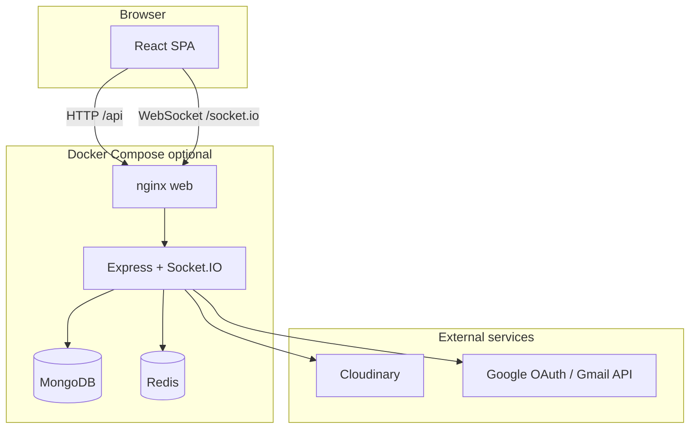

# DevConnect

A full-stack social network built for developers. Users sign up, build a public profile, share posts, grow a connection graph, collaborate on team projects, and chat in real time—similar in spirit to a professional developer community, not a generic CRUD demo.

---

## Table of contents

- [What this project does](#what-this-project-does)
- [Features](#features)
- [Architecture](#architecture)
- [Tech stack](#tech-stack)
- [Repository layout](#repository-layout)
- [How the app works](#how-the-app-works)
- [Data model](#data-model)
- [API overview](#api-overview)
- [Real-time (Socket.IO)](#real-time-socketio)
- [Prerequisites](#prerequisites)
- [Quick start](#quick-start)
- [Environment variables](#environment-variables)
- [Run with Docker](#run-with-docker)
- [Local development](#local-development)
- [Scripts & quality checks](#scripts--quality-checks)
- [CI/CD](#cicd)
- [Production deployment notes](#production-deployment-notes)
- [Troubleshooting](#troubleshooting)

---

## What this project does

DevConnect is a **monorepo** with two apps:

| Part | Folder | Role |
|------|--------|------|
| **Frontend** | `client/` | React SPA (Vite). Routes, UI, API calls, Socket.IO client. |
| **Backend** | `server/` | Express REST API, JWT auth, MongoDB persistence, optional Redis rate limits, Socket.IO server, Cloudinary uploads, email OTP. |

The frontend talks to the backend over **HTTP** (`/api/...`) and **WebSockets** (`/socket.io/`) for presence, typing indicators, and live updates tied to chat.

---

## Features

### Authentication & accounts

- Register with email; verify via **OTP** (email when configured, otherwise OTP logged in the server console in development).
- Login with email/password or **Google OAuth** (when `GOOGLE_*` and client `VITE_GOOGLE_CLIENT_ID` are set).
- **JWT access tokens** (Bearer header or cookie) plus **refresh tokens** for session renewal.
- Rate limits on login, registration, OTP send/verify (Redis-backed when `REDIS_URL` is set).

### Profiles & discovery

- Rich developer profile: bio, skills, location, social links, avatar, cover photo.
- Edit your profile; view **your** profile or **any user’s public profile** by ID.
- **Global search** for users and content.

### Social feed

- Create **text and image posts** (images via Cloudinary, max 5 MB).
- **Feed** with public or connections-only visibility.
- **Likes and comments** on posts; delete your own posts.

### Connections

- Send, accept, and reject **connection requests**.
- Pending requests list and **connection suggestions**.

### Projects

- Create **public or private** projects with tech stack and description.
- **Join requests** for private projects; owners accept or reject members.
- **Project group chat** (REST messages + dedicated chat UI route).

### Messaging & notifications

- **Direct messages** between users (1:1 chats).
- **Notifications** (read/unread, clear, unread count).
- **Online presence** and typing indicators over Socket.IO.

### UI

- Responsive layout with desktop navbar and mobile navigation.
- React Query for server state; toast feedback; protected routes for authenticated areas.

---

## Architecture



**Development (no Docker app containers):** Vite dev server on port **3000** proxies `/api` to the API on **8000**. Socket.IO connects to the API origin (or `VITE_SOCKET_URL`).

**Docker full stack:** nginx on port **80** serves the built SPA and reverse-proxies `/api`, `/socket.io/`, and `/health` to the API container. MongoDB and Redis run as sibling containers.

---

## Tech stack

| Layer | Technologies |
|-------|----------------|
| Frontend | React 19, Vite, React Router, TanStack React Query, Tailwind CSS, Axios, Socket.IO Client |
| Backend | Node.js 20+, Express 5, Mongoose, Socket.IO, JWT, express-validator, Multer |
| Data | MongoDB (primary database), Redis (optional, distributed rate limiting) |
| Media | Cloudinary |
| Email / OAuth | Nodemailer, Mailgen, Google Auth Library / Google APIs |
| Ops | Docker, Docker Compose, nginx, GitHub Actions (CI/CD), GHCR |

---

## Repository layout

```
devconnect/
├── client/                 # React frontend
│   ├── src/
│   │   ├── pages/          # Route-level screens (Home, Chat, Projects, …)
│   │   ├── components/     # Layout, posts, notifications, shared UI
│   │   ├── context/        # AuthContext (user session)
│   │   └── services/       # API wrappers (api.js, posts, chat, …)
│   ├── Dockerfile          # Multi-stage: Vite build → nginx
│   └── nginx.conf          # SPA + API/WebSocket proxy (used in Docker)
├── server/
│   ├── config/             # DB, Redis, env, indexes
│   ├── controllers/        # Route handlers
│   ├── middleware/         # JWT, uploads, validation
│   ├── models/             # Mongoose schemas
│   ├── routes/             # Express routers
│   ├── sockets/            # Socket.IO auth & events
│   ├── utils/              # Mail, rate limit helpers, errors
│   └── server.js           # App entry point
├── docker-compose.yml      # mongodb, redis, server, web (nginx)
├── docker-compose.prod.yml # Pull pre-built GHCR images (CD)
└── .github/workflows/      # ci.yml, cd.yml
```

---

## How the app works

### Authentication flow

1. User registers → OTP sent (or printed in dev) → email verified → account active.
2. Login returns access + refresh tokens; the client stores the access token and sends `Authorization: Bearer <token>` on API calls (cookies also supported on the server).
3. On **401**, the client tries `POST /api/auth/refresh-token`, then retries the request or redirects to login.

### Authorization

Most `/api/*` routes (except auth and health) use `verifyJWT` middleware, which loads the user from MongoDB and attaches `req.user`.

### Posts & images

Uploads hit Multer temporarily; the server uploads to **Cloudinary**, saves URLs on the user/post documents, and removes temp files.

### Rate limiting

Global API limiter plus stricter limits on auth and OTP routes. With **`REDIS_URL`**, counters are shared across API instances; without it, limits are in-memory (fine for single-process dev).

---

## Data model

MongoDB collections (Mongoose models in `server/models/`):

| Model | Purpose |
|-------|---------|
| `User` | Credentials, refresh token, core account fields |
| `Profile` | Public-facing profile data linked to user |
| `Post` | Feed posts, visibility, likes array, image URL |
| `Comment` | Threaded comments on posts |
| `Like` | Like relationships (posts/comments where used) |
| `Chat` | 1:1 conversation metadata and participants |
| `Message` | Chat messages |
| `Project` | Projects, members, visibility, join workflow |
| `ProjectGroupChat` | Project-scoped group messages |
| `Notification` | In-app notifications |
| `OTP` | Email verification codes (TTL index for expiry) |

Indexes for feeds, search, chats, and notifications are created at startup via `config/dbIndexes.js`.

---

## API overview

Base URL: **`/api`**. Protected routes require a valid JWT unless noted.

| Prefix | Responsibility |
|--------|----------------|
| `/api/auth` | Register, OTP, login, Google login, refresh, logout, current user |
| `/api/profiles` | CRUD-style profile ops, avatar/cover upload, search users |
| `/api/posts` | Create post, feed, user posts, like, comment, delete |
| `/api/projects` | List/create projects, join flow, project chat messages |
| `/api/connections` | Requests, accept/reject, list connections, suggestions |
| `/api/chats` | Send message, list messages, mark read |
| `/api/search` | Global search |
| `/api/notifications` | List, mark read, clear, unread count |

**Health:** `GET /health` — liveness check (not under `/api`).

---

## Real-time (Socket.IO)

Server: `server/sockets/chatSocket.js`. Client connects with `auth: { token: accessToken }`.

| Event (client → server) | Purpose |
|-------------------------|---------|
| `joinChat` | Join room for a 1:1 chat (validated participant) |
| `joinProjectChat` | Join room for project group chat (validated member) |
| `typing` / `stopTyping` | Typing indicators in a chat room |

| Event (server → client) | Purpose |
|-------------------------|---------|
| `onlineUsers` | List of user IDs currently connected |

Message **content** is persisted via REST (`/api/chats`, project chat routes); Socket.IO handles presence and typing.

---

## Prerequisites

- **Node.js 20+** and npm (for local dev)
- **MongoDB** (local, Docker, or Atlas)
- **Cloudinary** account (required for avatars, covers, post images)
- **Redis** (optional; recommended for production rate limits)
- **Docker & Docker Compose** (optional; for containerized stack)

---

## Quick start

**Fastest path with Docker (app + database + Redis + nginx):**

```bash
git clone https://github.com/Abhi-kumar23/DevConnect.git
cd DevConnect
cp server/.env.example server/.env
# Edit server/.env: JWT secrets, Cloudinary keys, etc.

docker compose up -d --build
```

Open **http://localhost**.

**Classic local dev (hot reload on frontend):**

```bash
cp server/.env.example server/.env
cp client/.env.example client/.env
# Fill server/.env (required) and client/.env as needed

docker compose up -d mongodb redis   # optional but recommended

cd server && npm install && npm run dev
cd client && npm install && npm run dev
```

Open **http://localhost:3000**.

---

## Environment variables

### Server (`server/.env`)

Copy from `server/.env.example`.

| Variable | Required | Description |
|----------|----------|-------------|
| `PORT` | No | API port (default `8000`) |
| `NODE_ENV` | No | `development` / `production` |
| `CLIENT_URL` | Yes* | Comma-separated browser origins for CORS |
| `MONGO_URI` | Yes | MongoDB connection string |
| `REDIS_URL` | No | Redis URL; omit for in-memory rate limits |
| `ACCESS_TOKEN_SECRET` | Yes | Long random string for JWT access tokens |
| `REFRESH_TOKEN_SECRET` | Yes | Long random string for refresh tokens |
| `CLOUDINARY_*` | Yes | Cloud name, API key, secret for uploads |
| `GOOGLE_CLIENT_ID` | No | Google sign-in (server verification) |
| `GOOGLE_CLIENT_SECRET` | No | Google OAuth |
| `GOOGLE_REFRESH_TOKEN` | No | Gmail API refresh token for sending mail |
| `GOOGLE_USER_EMAIL` | No | Sender address for OTP emails |

\*Required in production; defaults exist for local dev.

### Client (`client/.env`)

Copy from `client/.env.example`.

| Variable | Required | Description |
|----------|----------|-------------|
| `VITE_API_URL` | No | Defaults to `/api` in many setups; use full URL if API is on another host |
| `VITE_SOCKET_URL` | No | If unset, client uses `window.location.origin` (works with Vite proxy and nginx) |
| `VITE_GOOGLE_CLIENT_ID` | No | Enables Google button on login |

**Never commit `.env` files.** Only `.env.example` templates are in the repo.

---

## Run with Docker

### Full stack

Compose services: **mongodb**, **redis**, **server**, **web** (nginx).

- Compose sets `MONGO_URI`, `REDIS_URL`, and `CLIENT_URL` for containers; you still provide secrets in `server/.env`.
- Optional Google client ID for the **built** frontend: set `VITE_GOOGLE_CLIENT_ID` in a root `.env` before `docker compose up`.

```bash
docker compose up -d --build
```

### Infrastructure only

Run MongoDB and Redis in Docker while developing on the host:

```bash
docker compose up -d mongodb redis
```

Use in `server/.env`:

```env
MONGO_URI=mongodb://127.0.0.1:27017/devconnect
REDIS_URL=redis://127.0.0.1:6379
```

### Production images (GHCR)

After CI/CD pushes images, on a server with compose files and `server/.env`:

```bash
export IMAGE_TAG=<commit-sha-or-latest>
export SERVER_IMAGE=ghcr.io/<owner>/devconnect-server
export WEB_IMAGE=ghcr.io/<owner>/devconnect-web
docker compose -f docker-compose.yml -f docker-compose.prod.yml pull web server
docker compose -f docker-compose.yml -f docker-compose.prod.yml up -d --no-build web server
```

---

## Local development

| Service | Command | URL |
|---------|---------|-----|
| API | `cd server && npm run dev` | http://localhost:8000 |
| Client | `cd client && npm run dev` | http://localhost:3000 |
| Health | — | http://localhost:8000/health |

Vite proxies `/api` → `http://localhost:8000` (see `client/vite.config.js`).

**OTP in dev:** If Google email env vars are empty, OTP codes appear in the **server terminal** instead of being emailed.

**Image uploads:** Avatar, cover, and post images go to Cloudinary; max upload size **5 MB**.

---

## Scripts & quality checks

| Location | Command | Purpose |
|----------|---------|---------|
| `client/` | `npm run dev` | Vite dev server |
| `client/` | `npm run build` | Production build |
| `client/` | `npm run lint` | ESLint |
| `server/` | `npm run dev` | Nodemon API |
| `server/` | `npm run start` | Production Node |
| `server/` | `npm run check` | Syntax-check `server.js` |

**Full check (matches CI):**

```bash
cd client && npm ci && npm run lint && npm run build
cd ../server && npm ci && npm run check
```

---

## CI/CD

GitHub Actions live in `.github/workflows/`.

### CI (`ci.yml`)

On push/PR to **`main`**:

1. Client — install, lint, build  
2. Server — install, `npm run check`  
3. Docker — `docker compose build web server` (stub `server/.env` from example)

### CD (`cd.yml`)

On push to **`main`** or manual **workflow_dispatch**:

1. Build and push **`devconnect-server`** and **`devconnect-web`** to **GitHub Container Registry** (`latest`, `main`, commit SHA).  
2. Optional **deploy** when repository variable **`ENABLE_DEPLOY`** = `true` and secrets are set.

| Secret / variable | Purpose |
|-------------------|---------|
| `ENABLE_DEPLOY` (variable) | Turn on SSH deploy job |
| `VITE_GOOGLE_CLIENT_ID` | Optional; baked into client image at build |
| `DEPLOY_HOST`, `DEPLOY_USER`, `DEPLOY_SSH_KEY`, `DEPLOY_PATH` | SSH deploy target |
| `GHCR_DEPLOY_TOKEN` | Pull private images on the VPS |
| `DEPLOY_PORT` | Optional SSH port |

---

## Production deployment notes

- Use strong, unique **JWT secrets** and HTTPS in front of nginx.
- Set **`CLIENT_URL`** to your real frontend origin(s).
- Configure **email OAuth** for OTP in production (do not rely on console OTP).
- Make GHCR packages public or grant the deploy token **`read:packages`**.
- MongoDB and Redis: managed services or persistent volumes if self-hosted.
- Socket.IO behind nginx requires WebSocket upgrade headers (already in `client/nginx.conf`).

---

## Troubleshooting

| Issue | Things to check |
|-------|------------------|
| CORS errors | `CLIENT_URL` includes exact browser origin (scheme + host + port) |
| 401 on all requests | Token expired; refresh flow; clock skew; correct `ACCESS_TOKEN_SECRET` |
| Upload fails | Cloudinary env vars; file under 5 MB |
| Redis not used | `REDIS_URL` set and Redis reachable; server log should say “Redis connected” |
| Socket won’t connect | `VITE_SOCKET_URL` or same-origin proxy; JWT passed in `auth.token` |
| Docker compose build fails | Create `server/.env` from example (compose references `env_file`) |
| OTP never arrives | Configure Google email env vars or read OTP from server logs in dev |

---

## License

ISC (see `server/package.json`). Adjust this section if you add a root `LICENSE` file.

---

**Questions or contributions:** open an issue or PR on [GitHub](https://github.com/Abhi-kumar23/DevConnect).