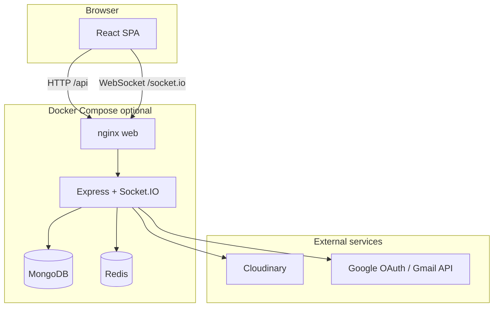

# DevConnect

A full-stack social network built for developers. Users sign up, build a public profile, share posts, grow a connection graph, collaborate on team projects, and chat in real time—similar in spirit to a professional developer community, not a generic CRUD demo.

---

## Table of contents

- [What this project does](#what-this-project-does)
- [Features](#features)
- [Architecture](#architecture)
- [Tech stack](#tech-stack)
- [Repository layout](#repository-layout)
- [How the app works](#how-the-app-works)
- [Data model](#data-model)
- [API overview](#api-overview)
- [Real-time (Socket.IO)](#real-time-socketio)
- [Prerequisites](#prerequisites)
- [Quick start](#quick-start)
- [Environment variables](#environment-variables)
- [Run with Docker](#run-with-docker)
- [Local development](#local-development)
- [Scripts & quality checks](#scripts--quality-checks)
- [CI/CD](#cicd)
- [Production deployment notes](#production-deployment-notes)
- [Troubleshooting](#troubleshooting)

---

## What this project does

DevConnect is a **monorepo** with two apps:

| Part | Folder | Role |
|------|--------|------|
| **Frontend** | `client/` | React SPA (Vite). Routes, UI, API calls, Socket.IO client. |
| **Backend** | `server/` | Express REST API, JWT auth, MongoDB persistence, optional Redis rate limits, Socket.IO server, Cloudinary uploads, email OTP. |

The frontend talks to the backend over **HTTP** (`/api/...`) and **WebSockets** (`/socket.io/`) for presence, typing indicators, and live updates tied to chat.

---

## Features

### Authentication & accounts

- Register with email; verify via **OTP** (email when configured, otherwise OTP logged in the server console in development).
- Login with email/password or **Google OAuth** (when `GOOGLE_*` and client `VITE_GOOGLE_CLIENT_ID` are set).
- **JWT access tokens** (Bearer header or cookie) plus **refresh tokens** for session renewal.
- Rate limits on login, registration, OTP send/verify (Redis-backed when `REDIS_URL` is set).

### Profiles & discovery

- Rich developer profile: bio, skills, location, social links, avatar, cover photo.
- Edit your profile; view **your** profile or **any user’s public profile** by ID.
- **Global search** for users and content.

### Social feed

- Create **text and image posts** (images via Cloudinary, max 5 MB).
- **Feed** with public or connections-only visibility.
- **Likes and comments** on posts; delete your own posts.

### Connections

- Send, accept, and reject **connection requests**.
- Pending requests list and **connection suggestions**.

### Projects

- Create **public or private** projects with tech stack and description.
- **Join requests** for private projects; owners accept or reject members.
- **Project group chat** (REST messages + dedicated chat UI route).

### Messaging & notifications

- **Direct messages** between users (1:1 chats).
- **Notifications** (read/unread, clear, unread count).
- **Online presence** and typing indicators over Socket.IO.

### UI

- Responsive layout with desktop navbar and mobile navigation.
- React Query for server state; toast feedback; protected routes for authenticated areas.

---

## Architecture



**Development (no Docker app containers):** Vite dev server on port **3000** proxies `/api` to the API on **8000**. Socket.IO connects to the API origin (or `VITE_SOCKET_URL`).

**Docker full stack:** nginx on port **80** serves the built SPA and reverse-proxies `/api`, `/socket.io/`, and `/health` to the API container. MongoDB and Redis run as sibling containers.

---

## Tech stack

- Client: React, Vite, Tailwind CSS, React Query, Socket.IO Client
- Server: Express, MongoDB/Mongoose, Socket.IO, JWT, Cloudinary, Nodemailer

## Run locally

Requirements: Node.js 20+, MongoDB (local or Atlas), and Cloudinary credentials for image uploads.

1. Create configuration files from the templates:

   ```bash
   cp server/.env.example server/.env
   cp client/.env.example client/.env
   ```

2. Fill in `server/.env`. At minimum configure `MONGO_URI`, `ACCESS_TOKEN_SECRET`, `REFRESH_TOKEN_SECRET`, and all three Cloudinary values. Configure the Google/email values only when using Google sign-in or email OTP delivery.

3. Start the API in one terminal:

```bash
docker compose up -d mongodb redis
```

Use in `server/.env`:

```env
MONGO_URI=mongodb://127.0.0.1:27017/devconnect
REDIS_URL=redis://127.0.0.1:6379
```

### Production images (GHCR)

After CI/CD pushes images, on a server with compose files and `server/.env`:

```bash
export IMAGE_TAG=<commit-sha-or-latest>
export SERVER_IMAGE=ghcr.io/<owner>/devconnect-server
export WEB_IMAGE=ghcr.io/<owner>/devconnect-web
docker compose -f docker-compose.yml -f docker-compose.prod.yml pull web server
docker compose -f docker-compose.yml -f docker-compose.prod.yml up -d --no-build web server
```

---

## Local development

| Service | Command | URL |
|---------|---------|-----|
| API | `cd server && npm run dev` | http://localhost:8000 |
| Client | `cd client && npm run dev` | http://localhost:3000 |
| Health | — | http://localhost:8000/health |

Vite proxies `/api` → `http://localhost:8000` (see `client/vite.config.js`).

**OTP in dev:** If Google email env vars are empty, OTP codes appear in the **server terminal** instead of being emailed.

**Image uploads:** Avatar, cover, and post images go to Cloudinary; max upload size **5 MB**.

---

## Scripts & quality checks

| Location | Command | Purpose |
|----------|---------|---------|
| `client/` | `npm run dev` | Vite dev server |
| `client/` | `npm run build` | Production build |
| `client/` | `npm run lint` | ESLint |
| `server/` | `npm run dev` | Nodemon API |
| `server/` | `npm run start` | Production Node |
| `server/` | `npm run check` | Syntax-check `server.js` |

**Full check (matches CI):**

```bash
cd client && npm ci && npm run lint && npm run build
cd ../server && npm ci && npm run check
```

## CI/CD (GitHub Actions)

### CI (`.github/workflows/ci.yml`)

Runs on pushes and pull requests to `main`:

- Client: `npm ci`, ESLint, production build
- Server: `npm ci`, `node --check` on `server.js`
- Docker: `docker compose build web server` (uses `server/.env.example` as a stub env file)

### CD (`.github/workflows/cd.yml`)

Runs on pushes to `main` and manual **workflow dispatch**:

1. Builds and pushes `devconnect-server` and `devconnect-web` images to **GitHub Container Registry** (`ghcr.io/<owner>/...`), tagged with `latest`, `main`, and the commit SHA.
2. **Deploy** job (GitHub **production** environment): SSH to your VPS, pulls images, and runs Compose with `docker-compose.prod.yml`.

#### Repository secrets (Settings → Secrets and variables → Actions)

| Secret | Used for |
|--------|----------|
| `VITE_GOOGLE_CLIENT_ID` | Optional; baked into the nginx/client image at build time |
| `DEPLOY_HOST` | VPS hostname or IP |
| `DEPLOY_USER` | SSH user |
| `DEPLOY_SSH_KEY` | Private key (PEM) for SSH |
| `DEPLOY_PATH` | Directory on the server with `docker-compose.yml`, `docker-compose.prod.yml`, and `server/.env` |
| `GHCR_DEPLOY_TOKEN` | PAT or fine-grained token with `read:packages` so the server can `docker pull` from GHCR |
| `DEPLOY_PORT` | Optional SSH port (defaults to 22 in the workflow if omitted) |

On the VPS, clone the repo (or copy compose files), create `server/.env` with production values, then make GHCR packages **public** or grant the deploy token access. First deploy:

```bash
export IMAGE_TAG=<commit-sha-or-latest>
export SERVER_IMAGE=ghcr.io/<owner>/devconnect-server
export WEB_IMAGE=ghcr.io/<owner>/devconnect-web
docker compose -f docker-compose.yml -f docker-compose.prod.yml pull web server
docker compose -f docker-compose.yml -f docker-compose.prod.yml up -d --no-build web server
```

Until deploy secrets are configured, the **build-and-push** job still publishes images. To run SSH deploy, set repository variable **`ENABLE_DEPLOY`** to `true` and add the deploy secrets below.

---

## CI/CD

GitHub Actions live in `.github/workflows/`.

### CI (`ci.yml`)

On push/PR to **`main`**:

1. Client — install, lint, build  
2. Server — install, `npm run check`  
3. Docker — `docker compose build web server` (stub `server/.env` from example)

### CD (`cd.yml`)

On push to **`main`** or manual **workflow_dispatch**:

1. Build and push **`devconnect-server`** and **`devconnect-web`** to **GitHub Container Registry** (`latest`, `main`, commit SHA).  
2. Optional **deploy** when repository variable **`ENABLE_DEPLOY`** = `true` and secrets are set.

| Secret / variable | Purpose |
|-------------------|---------|
| `ENABLE_DEPLOY` (variable) | Turn on SSH deploy job |
| `VITE_GOOGLE_CLIENT_ID` | Optional; baked into client image at build |
| `DEPLOY_HOST`, `DEPLOY_USER`, `DEPLOY_SSH_KEY`, `DEPLOY_PATH` | SSH deploy target |
| `GHCR_DEPLOY_TOKEN` | Pull private images on the VPS |
| `DEPLOY_PORT` | Optional SSH port |

---

## Production deployment notes

- `VITE_API_URL` defaults to `/api` for Vite development and can be set to a deployed API URL.
- `VITE_SOCKET_URL` should point to the Socket.IO server.
- `CLIENT_URL` can contain comma-separated allowed browser origins.
- When email OAuth credentials are omitted in development, verification OTPs are printed in the API terminal. Production requires configured email delivery.
- Never commit `.env` files; templates are included for safe setup.
